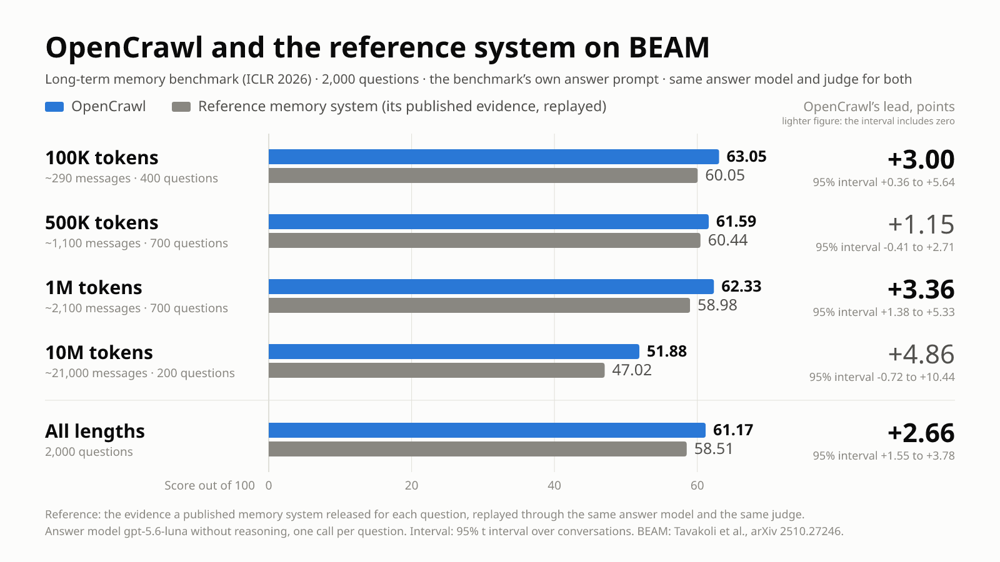

# OpenCrawl on BEAM

[](https://github.com/getopencrawl/beam-eval/actions/workflows/verify.yml)

An evaluation of [OpenCrawl](https://github.com/getopencrawl/opencrawl-core)'s search and memory on
[BEAM](https://arxiv.org/abs/2510.27246) (ICLR 2026), a benchmark of long-term conversational memory: 100
conversations of 100K to 10M tokens, 2,000 questions, ten abilities.

This repository contains the harness, the per-question records of the runs, a script that recomputes the reported
numbers from those records, and a [paper](paper/opencrawl-beam.pdf).

The comparison is with one published memory system, and it is controlled: the evidence that system published for
each question and the evidence OpenCrawl retrieved go through the same answer call and the same judge, and are
compared question by question. That system is not named in this repository. It is called the reference system, and
[a note](docs/reference-system.md) says what of it was used and what can be checked without it.

**In short:** under BEAM's own answer prompt OpenCrawl scores 61.17 against 58.51 (+2.66; 95% interval +1.55 to +3.78), and under the
annotation-aided prompt 88.25 against 87.41 (+0.84; +0.25 to +1.43). Against the reference system's own published answers, which we could not
regenerate, OpenCrawl is 0.83 behind. The system evaluated is not a released OpenCrawl configuration, and it was
developed on this benchmark.

<picture>
  <source media="(prefers-color-scheme: dark)" srcset="figures/beam-head-to-head-dark.png">
  
</picture>

## Result

Scores are the percentage of rubric points awarded, averaged over questions. "Reference evidence" is the reference
system's published evidence answered by the same model call as OpenCrawl's.

The interval is a 95% Student t interval over per-conversation mean differences. The conversation is the unit, not
the question: the twenty questions of a conversation share its index and its notes. `verify.py` also computes two
paired-bootstrap intervals, over questions and over conversations. They are narrower, most of all at 10M, which has
only ten conversations. Below, a lead is called clear when all three intervals exclude zero.

| | Questions | OpenCrawl | Reference evidence | Lead | 95% interval |
|---|---:|---:|---:|---:|---|
| **BEAM's own answer prompt** | | | | | |
| 100K tokens | 400 | 63.05 | 60.05 | +3.00 | +0.36 to +5.64 |
| 500K tokens | 700 | 61.59 | 60.44 | +1.15 | −0.41 to +2.71 |
| 1M tokens | 700 | 62.33 | 58.98 | +3.36 | +1.38 to +5.33 |
| 10M tokens | 200 | 51.88 | 47.02 | +4.86 | −0.72 to +10.44 |
| All | 2,000 | **61.17** | 58.51 | **+2.66** | +1.55 to +3.78 |
| **Annotation-aided prompt** | | | | | |
| 100K tokens | 400 | 90.17 | 89.51 | +0.66 | −0.68 to +2.00 |
| 500K tokens | 700 | 87.89 | 87.51 | +0.38 | −0.59 to +1.36 |
| 1M tokens | 700 | 89.46 | 87.75 | +1.70 | +0.63 to +2.78 |
| 10M tokens | 200 | 81.44 | 81.69 | −0.25 | −2.13 to +1.64 |
| All | 2,000 | **88.25** | 87.41 | **+0.84** | +0.25 to +1.43 |

The two prompts measure different things. BEAM's own answer prompt gives the answer model the question and the
retrieved evidence. The annotation-aided prompt, the one behind scores near 90%, also gives it guidance built from
the dataset's annotations: which topics to put in order, what a summary should cover, which preference applies, why a
question cannot be answered. With no memory at all that prompt scores 46.6% at 100K; BEAM's own prompt scores 17.9%.

### What this shows

- Under one answer call and one judge, OpenCrawl's evidence scores higher than the reference system's published
  evidence over all 2,000 questions: by 2.66 points under BEAM's own prompt (+1.55 to +3.78) and by 0.84
  under the annotation-aided prompt (+0.25 to +1.43). Both leads are clear: every interval we compute excludes zero.
- By length under BEAM's own prompt the lead is +3.00 at 100K, +1.15 at 500K, +3.36 at 1M, +4.86 at 10M. It is clear at 100K and 1M. At 10M both bootstrap intervals exclude zero, but the t interval over its ten conversations does not (−0.72 to +10.44), so we do not call that lead clear.
- By length under the annotation-aided prompt the lead is +0.66 at 100K, +0.38 at 500K, +1.70 at 1M, −0.25 at 10M. It is clear at 1M.
- **What holds under every check.** The reference side can be set up in four ways: all replays pooled (the table
  above), the replays of the same day alone, and the evidence re-presented in time order or in OpenCrawl's item format.
  The lead is clear in all four overall and at 1M, under both prompts. No other single length holds throughout:
  under BEAM's own prompt the lead is clear at 100K in one, 500K in none, 10M in one of the four set-ups, and under the
  annotation-aided prompt at 100K in none, 500K in one, 10M in none. The two set-ups "in time order" sort the reference evidence by
  timestamps as text, which is not exactly the order of the moments ([Limits](#limits)).
- By ability under BEAM's own prompt the largest leads are on knowledge update (77.10 against 68.27), summarization (57.65 against 49.39) and instruction following (61.99 against 57.14). The lead is clear on 5 of the ten abilities. OpenCrawl is not clearly behind on any; its lowest relative results are abstention (64.17 against 66.79) and information extraction (75.19 against 78.58). On information extraction the deficit of 3.39 is close to clear: two of the three intervals exclude zero, and the t interval is −6.81 to +0.04.

### What it does not show

- **Not a ranking of memory systems.** Other vendors report BEAM scores from their own runs, each under its own
  protocol. The two whose protocols we have read use other answer models and other judges; one uses its own answer
  prompt, the other a prompt of the annotation-aided kind
  ([log](docs/experiment-log.md#other-published-beam-numbers)). Those numbers are not comparable with these, in
  either direction, and nothing here places OpenCrawl among them.
- **Not a higher score than the reference system's published answers.** Graded by the same judge, its published
  answer set scores 89.08 against OpenCrawl's 88.25: OpenCrawl is 0.83 behind, and the interval (−1.49 to −0.16) excludes zero. The gap is widest at 10M
  (−3.04, −6.13 to +0.06). Its own reported score is about 90. We could not regenerate those answers from its
  published evidence, which is why the comparison above is on evidence. We are not claiming an error on its side;
  [the note on the reference system](docs/reference-system.md) has the details and the checks.
- **Not a held-out result.** BEAM has no held-out split. The system was developed on the questions it is reported
  on; see [how selection was limited](#how-selection-was-limited-and-where-it-was-not).
- **Not a released product configuration.** See [what was evaluated](#what-was-evaluated).

## A correction made before publication

A review of this repository before it was published found that two note-writing prompts carried benchmark content
as examples: the five example lines of the fact-card prompt restated what five test questions ask for, and the
example in the conflict-note prompt was the conflict of a sixth. The passes that write notes were never given a
question or an answer as input, but for these six questions their instructions contained the answer.

The examples were replaced with invented ones, the fact cards and conflict notes were rebuilt, and the full system
was run again. That rebuilt system is the one reported above. The plan, including that its numbers would replace the
earlier ones whatever they were, was written into [the log](docs/experiment-log.md) and committed at 09:16 UTC on
2026-11-12, before it was run; the runs finished between 11:40 and 13:04. This repository is published
without its development history; its first commit is a snapshot made on 2026-11-12. That timing therefore rests on
our word.

| Lead over the reference evidence, all 2,000 questions | BEAM's own prompt | Annotation-aided prompt |
|---|---|---|
| Reported: notes rebuilt from the corrected prompts | +2.66 (+1.55 to +3.78) | +0.84 (+0.25 to +1.43) |
| Before the rebuild, as first measured | +2.94 (+1.75 to +4.13) | +1.16 (+0.55 to +1.78) |
| Before the rebuild, without the six questions | +2.99 (+1.81 to +4.20) | +1.15 (+0.53 to +1.77) |

What the rebuild changed:

- **The six questions score about the same.** Summed over the six, 2.7 of 6 points before and 3.1 after under
  BEAM's own prompt, 4.3 and 4.0 under the annotation-aided prompt. The rebuilt cards state the same facts,
  because the facts are in the user's messages; `verify.py --all` prints the six one by one.
- **Over all questions the difference is within the noise**: the rebuilt system against the earlier one is at
  −0.17 (−0.89 to +0.54) under BEAM's own prompt and −0.24 (−0.64 to +0.16) under the
  annotation-aided prompt.
- **One length moved by more: 10M under the annotation-aided prompt**, 81.44 against 83.69 before (−2.25, −3.22 to −1.28).
  The lead over the reference evidence there was +2.44 and is now −0.25 (−2.13 to +1.64). A fourth run on the old
  notes, made on the day of the rebuilt runs, scored 82.00 there, so the drop cannot be pinned on the notes.
  One run does not settle whether the answer model behaved differently that day or the three earlier runs were
  high. Either way, the earlier lead at that length did not hold.

The earlier runs stay in the repository, in `results/opencrawl/full-system-original-notes/`, with the notes they
searched in `memory/before-rebuild/`, and the examples as they were are in
[docs/note-prompts-before-correction.md](docs/note-prompts-before-correction.md). The paper's account of how the
system was built (its Sections 5.5 to 5.7) rests on those runs and on others made with the same notes.

## Check the numbers

```sh
git clone https://github.com/getopencrawl/beam-eval && cd beam-eval
python verify.py          # about a minute; Python 3.10 or newer, no dependencies, no network
python verify.py --all    # every table the script covers; a few minutes
```

`verify.py` does four things:

- Where a record keeps the judge's verdict beside its score, it re-derives the score from the verdict. That covers
  all 12,000 scores of the reported OpenCrawl runs and 8,000 of the 23,100 reference-evidence scores. The earlier
  replays and the 6,000 re-graded published-answer scores were stored without verdicts. Over the whole repository,
  125,958 of 265,852 scores can be re-derived.
- It recomputes each run's score from its records, and each comparison from the runs: per-question means over runs,
  differences, the t interval, and 10,000 bootstrap resamples with a fixed seed.
- It reads the table above out of this file.
- It checks all of it against [`results/expected.json`](results/expected.json), the numbers quoted here, in the paper
  and in the log, and exits non-zero on any difference. Numbers quoted in prose are not read back from the documents.

CI runs it on every push. `python verify.py --help` lists which tables of the paper it covers and which it does not.

**The harness is not the code the runs were made with, line for line.** The runs used version 1, which took its
dataset loader, scorer and logging, and in adapted form its model client and the frame of its run script, from the
reference system's open-source BEAM harness. That code is not redistributed here. Version 2, published here,
replaces it with our own implementations. They were compared with the replaced modules on every conversation and
prompt, on every stored answer and verdict, and on the model client's requests for a scripted set of replies,
without a difference ([harness/README.md](harness/README.md)).
`python harness/check_harness.py` repeats the part of that comparison that needs only this repository.
One full run of version 2 was made per length under each prompt and set against the three reported runs, question by
question: over all 2,000 questions it scored 60.54 against 61.17 under BEAM's own prompt (−0.63; −1.52 to +0.26) and
88.18 against 88.25 under the annotation-aided prompt (−0.07; −0.61 to +0.46). Neither interval excludes zero: no difference was detected. One run cannot show more than that; it resolves about a point.
Under BEAM's own prompt it is below each of the three reported runs (60.91, 61.33, 61.27). Stored prompts of a reported run, answered again that evening, scored −0.57
(−2.31 to +1.14) against their first answers under that prompt, which points at the day rather than the harness, without settling it.
The run is in `results/opencrawl/published-harness-run/` and is not part of the reported numbers.

To go further than recomputing: OpenCrawl's side can be answered and judged again from stored prompts with an API
key and no memory system, and the whole pipeline can be rerun. The reference side cannot be generated again from this
repository alone, because that system's published records are not included. See
[docs/reproduce.md](docs/reproduce.md).

## How the comparison works

1. **One answer call.** `gpt-5.6-luna` with reasoning off, one call per question, default temperature, the prompt
   text unchanged. This is the model and setting of the reference system's own harness.
2. **One judge.** The same model grades every answer against BEAM's rubric items (0, 0.5 or 1 each), with the judge
   prompts of the published adapter that the reference harness uses (attributed to ExaBase; see
   [NOTICE.md](NOTICE.md)); event ordering is scored with Kendall's tau-b.
   So "BEAM's own prompt" above means BEAM's answer prompt, not BEAM's whole protocol. Both systems' data were
   shaped and both systems' answers scored by the same code, the reference harness's own; see
   [Check the numbers](#check-the-numbers) for what this repository publishes in its place.
3. **The same budget.** OpenCrawl's context is capped at the mean size of the context the reference system's answer
   model read at each length (about 11,000 tokens).
4. **Several answer runs.** Three per length for OpenCrawl. For the reference evidence, six answer runs per length under BEAM's own prompt, and five to seven under the annotation-aided prompt:
   every replay of the unmodified evidence made with this same answer call, with one exception. Replays made to test
   other settings (reasoning levels, another API surface, the API router) are not part of it. The exception: two later replays of the 100K evidence, made with the published harness to check it. With
   them the 100K leads would be +3.15 and +0.68 instead of +3.00 and +0.66.
   A question's score is its mean over runs.
5. **Paired statistics.** The difference is taken per question, averaged per conversation, and given a t interval
   over conversations.

**What retrieval is given.** The question, and the moment it is asked. For knowledge-update questions that moment is
the turn BEAM marks as the update (for 10 of the 200 the dataset cites no turn that can be found, and they are asked
at the end like the others); this comes from the dataset, is the reference harness's protocol, and applies to
both systems. It is a real hint: for 182 of the 200 such questions in the earlier runs, that turn was the newest item
in OpenCrawl's evidence, and knowledge update is where OpenCrawl's lead is largest. Without the knowledge-update
questions the lead is +1.98 (+0.91 to +3.05) under BEAM's own prompt and +0.48 (−0.09 to +1.05) under the
annotation-aided prompt.

**Runs of the same day.** The reference evidence was replayed again on the day of the reported runs. Against those
replays alone the lead is +2.45 (+1.25 to +3.65) under BEAM's own prompt and +0.68 (+0.01 to +1.35)
under the annotation-aided prompt. By length, only 1M is clear against them; at 10M under BEAM's own prompt the lead
is then +3.74 (−1.94 to +9.42).

**How the reference evidence is presented.** Its evidence arrives in rank order in its own serialization;
OpenCrawl's is in time order. Re-presenting the reference evidence in time order, and in OpenCrawl's item
format, gives +2.37 (+1.13 to +3.61) and +3.03 (+1.88 to +4.18) under BEAM's own prompt, and
+0.68 (+0.09 to +1.27) and +1.25 (+0.61 to +1.88) under the annotation-aided prompt. All four overall leads are clear. Single lengths are less stable: at 10M under the annotation-aided prompt, for example, the lead against the
reference evidence in OpenCrawl's format is −1.19 (−3.69 to +1.31).
In these two set-ups, as in OpenCrawl's own evidence, "time order" is the order of the timestamps as written, which
is not always the order of the moments; see [Limits](#limits).

## What was evaluated

A self-hosted OpenCrawl built from the branch
[`search-relevance-stemming`](https://github.com/getopencrawl/opencrawl-core/tree/search-relevance-stemming) of
opencrawl-core (commit `95863d8`, on top of version 0.2.57), driven by the recall procedure in
[`harness/run.py`](harness/run.py), over memory notes written by three passes in this repository. The branch was
proposed to opencrawl-core as a pull request, which was closed without being merged. The runs were made at commit
`97ed5b0`, which has the same tree; that repository's history was rewritten on 2026-11-11.

| Part | Where it lives | What it does |
|---|---|---|
| Search | opencrawl-core, branch `search-relevance-stemming` | BM25 with stemming, time bounds and time order, a role filter, learned-sparse ranking inside the search cluster, passages of at most 2,000 characters, neighbour fetch |
| Recall | `harness/run.py` | The question plus three rewritten queries, each searched twice (everything, and the user's messages only), fused; up to three follow-up queries; the twelve best messages read in full; evidence in time order |
| Per-turn notes | `harness/notes.py`, `turn_notes.py` | A note-taker reads each conversation and writes dated bullets |
| Fact cards | `harness/facts.py` | What each of the user's messages states, as short lines |
| Conflict notes | `harness/conflicts.py` | A later denial of something the user reported earlier |

The notes are stored through OpenCrawl's ordinary memory API and searched like any other memory file. The passes are
given the conversation and nothing else; the notes themselves are in [`memory/`](memory/).

**This is not what a released OpenCrawl does by itself today.** The branch is not merged. The main branch of
opencrawl-core (0.3.10 on 2026-11-12) has since gained its own time bounds and time order, a role filter, neighbour
links and boundary-aware passages, in a different form; it has no stemming and no semantic retrieval. The recall
procedure and the note-writing passes run from this repository. The untouched baseline, one BM25 search on OpenCrawl
0.2.54, scores 53.6% under BEAM's own prompt and 83.5% under the annotation-aided one.

**Cost.** One question takes fourteen searches, two small model calls on the retrieval side (about 2,400 tokens), one
answer call (about 11,000 prompt tokens) and on average three judge calls under the annotation-aided prompt and five
under BEAM's own. Writing one version of the memory took about 410 million model tokens: 380 million for the notes,
24 million for the fact cards and 4 million for the conflict pass. The last two were written twice because of the
rebuild described above, about 28 million more.

**What the answer model was given** is stored for one run of each length under each prompt, in full, and
`verify.py --all` checks those prompts: every evidence item holds only rank, time, role, turn and text, and none
carries a date after its question.

## How selection was limited, and where it was not

More than fifty configurations and eighteen paired variants were tried on BEAM's questions over three days. Their
records are in [`results/`](results/), including 18 runs that turned out to be invalid, and
[the experiment log](docs/experiment-log.md) describes each. Two sets of records are left out: a third-party
relevance model was tried as a filter and withdrawn within the hour, and its records were never analysed; and one
development run (`t28`) was stopped and discarded when its memory was found to be contaminated by an earlier
experiment. Work done after the reported runs, on 2026-11-13, is not in this repository either; the last entry of
the log says what it was. It did not change the reported system or its numbers.

What limits how much the reported numbers owe to that search:

- **Configurations were fixed before their reported runs**, and every one of those runs is reported.
- **A replication declared in advance.** The first result with fact cards under BEAM's own prompt rested on two runs.
  More runs for both sides were declared before they were made and pooled whatever they showed.
- **Rules written before results.** Conflict notes had to clear a paired test under both prompts to be adopted. The
  rebuild after the leak was declared, with its consequence, before it was run.
- **Paired tests on identical retrieval** for changes too small for whole-run comparisons to resolve.

What these do not cover:

- **The headline comparison was chosen after seeing data.** The first comparison was with the reference system's
  published answers under the annotation-aided prompt, where OpenCrawl trailed and still trails. The replay of its
  evidence, and the comparison under BEAM's own prompt, came afterwards.
- **The benchmark informed the design.** BEAM's cited evidence turns were used to measure search recall, and that is
  how stemming, the sparse weight and the user-only search pass were chosen. Reading whole messages and writing fact
  cards were prompted by what the reference system's published evidence contains. Prompts were revised after reading
  failed questions, which is how the leak above happened.
- **The rule for conflict notes was lenient on one side.** It followed a first form that had failed at 1M, and under
  the annotation-aided prompt it only required that the notes cost less than half a point.

We do not know how the reference system was developed.

## If you use BEAM

Four things measured along the way that affect anyone comparing scores on this benchmark:

- **The annotation-aided prompt answers much of the benchmark by itself**: 46.6% with empty evidence, including 100%
  on abstention and event ordering. Scores under it should be read next to scores under BEAM's own prompt.
- **A published answer set is not a reproducible baseline.** The reference system's answers score 1.1 to 2.8 points
  above what its own published evidence gave through the same model six weeks later, depending on the length. We do
  not know why, and we are not claiming an error on its side. Publishing the evidence made a fair comparison possible
  anyway.
- **Runs and judges vary.** Answer runs of one configuration differ by one to two points on 700 questions and by
  two to three at 10M; grading identical answers again moves the score by 0.1 to 1.0.
- **Most remaining losses are not retrieval misses.** In a replay of the base system's retrieval under the
  annotation-aided prompt, about two thirds of the lost points fall on questions for which every turn BEAM cites
  was in the evidence, as a passage or as a note about that turn.

## Limits

- One answer model, and the judge is the same model.
- The reference system is not named here and its published records are not included. Its side of the comparison
  can be recomputed from the per-question scores in `results/reference/`, not generated again; that those scores
  came from its published evidence, unmodified, is taken on trust.
- The reference evidence is a snapshot of that system at its publication; we could not run it.
- **Evidence was not always in the order it was said.** The harness sorts evidence by timestamp, comparing the
  timestamps as text. A timestamp on a whole second is written without a fraction and then sorts after the others of
  its second, so the first message of a conversation (and turns 1000, 2000 and so on) can appear after messages that
  followed it. In the stored prompts of the reported system this happened in 867 of 4,000. Answered
  again with the evidence in the order of the moments, twice per arm, those questions scored +0.06 (−1.28 to +1.42) under
  BEAM's own prompt and +0.12 (−0.69 to +1.02) under the annotation-aided prompt against the same prompts as run
  (bootstrap over questions). Averaged within each conversation first, the differences are +0.24 (−1.25 to +1.73) and
  −0.31 (−1.15 to +0.53) (t over conversations). No interval excludes zero: the order made no difference we can measure.
  Spread over all questions the first pair is +0.01 and +0.03. Only one of the three reported runs per length stores its
  prompts, so only that run was replayed. The harness keeps this order, so that it remains the code of the
  reported runs. The two re-presentations of the reference evidence in "time order" have the same kind of flaw more
  often, because its timestamps drop trailing zeros: there the order as written differs from the order of the
  moments in 1,258 of the 2,000 questions. We have not rerun those with the order corrected.
- In four of the ten 10M conversations BEAM dates a batch of turns before the batch that precedes it. Timestamps
  follow BEAM's dates, so for those conversations time order is not conversation order, and a question asked as of
  a moment cannot see turns that BEAM dates later even when they were said earlier. This applies to both systems.
- The context cap matches the reference system on average per length, not per question.
- 10M has 200 questions from ten conversations; its intervals are wide, and no lead there is clear in the reported
  comparison. In one of the four set-ups of the reference side, the one with its evidence in time order, the 10M lead
  under BEAM's own prompt is clear.
- The earlier runs record which turns and queries made up the evidence, not its text. Runs made since store it for
  one run per length.
- Replays of the reference evidence made before 2026-11-12 and the re-graded published answers keep scores (and, for
  the replays, the last answer of each question), not the verdicts, so those scores cannot be re-derived. The paired
  replays keep scores and answers without verdicts as well.
- Memory writing is expensive and was done once per version of the prompts; a rerun writes different notes.

## Layout

| Path | Contents |
|---|---|
| [`verify.py`](verify.py) | Recomputes the reported numbers from `results/`. |
| [`results/`](results/) | Per-question records of 358 runs, grouped by purpose, with a map from the paper's tables to runs. |
| [`memory/`](memory/) | The notes, fact cards and conflict notes written for the benchmark. |
| [`harness/`](harness/) | The code that runs the evaluation, and a check of it against the stored records. |
| [`paper/`](paper/) | The paper: [PDF](paper/opencrawl-beam.pdf), [Markdown](paper/opencrawl-beam.md). |
| [`docs/reference-system.md`](docs/reference-system.md) | What was replayed from the reference system's publication, what of it is and is not here, and the limits of that. |
| [`docs/reproduce.md`](docs/reproduce.md) | Recomputing, answering again, and running everything. |
| [`docs/note-prompts-before-correction.md`](docs/note-prompts-before-correction.md) | The examples two note-writing prompts carried before the correction described above. |
| [`docs/experiment-log.md`](docs/experiment-log.md) | The chronological record, including what did not work. |
| [`figures/`](figures/) | The chart above and the script that draws it. |

## License and credits

Code: [Apache 2.0](LICENSE). The annotation-aided prompt and the judge prompts come from a published BEAM adapter
attributed to ExaBase. That adapter matches the BEAM adapter of the Agent Memory Benchmark as first added there
(2026-04-01), except in part of the answer prompt. The prompts are reproduced unchanged, with that credit, and are
not covered by the license.
Everything under `results/` and `memory/` derives from the BEAM dataset and is distributed under CC BY-SA 4.0.
[NOTICE.md](NOTICE.md) says what belongs to whom.

BEAM is the work of Mohammad Tavakoli, Alireza Salemi, Carrie Ye, Mohamed Abdalla, Hamed Zamani and J Ross Mitchell:
*Beyond a Million Tokens: Benchmarking and Enhancing Long-Term Memory in LLMs*, ICLR 2026.

## Citing

```bibtex
@misc{opencrawl2026beam,
  title        = {Searchable Agent Memory at Ten Million Tokens},
  author       = {{OpenCrawl team}},
  year         = {2026},
  howpublished = {\url{https://github.com/getopencrawl/beam-eval}}
}
```

Questions and corrections are welcome as issues.
