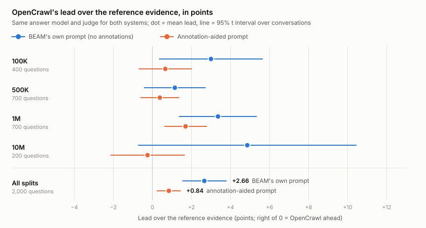

# Searchable Agent Memory at Ten Million Tokens

**Point-in-time, role-aware and note-augmented retrieval in OpenCrawl, and a controlled way to compare memory systems**

*OpenCrawl team · November 2026*

## Abstract

Agents that work with a user for months must recall what was said long ago: facts, revisions, standing instructions and preferences. We treat this as retrieval over captured agent sessions in OpenCrawl, which indexes agent transcripts and the agents' own memory files in one search realm behind two tools, `search` and `fetch`. Starting from a BM25 baseline we add point-in-time bounds, role-aware recall, in-cluster learned-sparse retrieval, iterative query rewriting, whole-message reading, and three kinds of agent-written memory note: per-turn notes, fact cards and conflict notes.

On BEAM (100 conversations of 100K to 10M tokens, 2,000 questions, ten memory abilities), with a fixed reader and judge, the system raises the score from 53.6% to 61.2% under the benchmark's own answer prompt, and from 83.5% to 88.3% under a widely used prompt that injects dataset annotations.

Published scores of memory systems are hard to compare, because they mix memory quality with the answer model's version, its API route and the day it ran. We therefore introduce a **controlled comparison**: the evidence a published system released for each question is passed through the same answer call and judge as ours. Against the published system with the highest BEAM scores we know of, OpenCrawl's evidence scores 61.17 against 58.51 under BEAM's own prompt (+2.66 points; 95% interval +1.55 to +3.78, a t interval over conversations). By conversation length the lead is clear at 100K and 1M. At 10M the lead is the largest in size (+4.86), but its interval over ten conversations includes zero (−0.72 to +10.44). Across four ways of setting up the reference side, the overall lead and the lead at 1M are clear in every one. Under the annotation-aided prompt, which reaches 46.6% with no memory at all, the difference is +0.84 (+0.25 to +1.43), and it is clear at 1M only. That system's published answers score 0.83 above ours under our judge (−1.49 to −0.16); we could not regenerate them from its own published evidence, on the direct API route or, at the two splits where we could test it, through the API router its harness uses.

A review before publication found that two of our note-writing prompts had used benchmark content as examples. The notes were rebuilt from corrected prompts, and the numbers above are those of the rebuilt system; the earlier ones are reported beside them (Section 4.3).

We report what each component contributed, the changes that did not help, and seven methodological findings, among them that most remaining losses occur with the needed evidence already in front of the reader.

## 1. Introduction

Coding and assistant agents increasingly work over long horizons. A user tells an agent that a deadline moved, asks it never to omit version numbers, or mentions a budget, and expects all of it to hold months later. Context windows do not solve this: at ten million tokens a conversation exceeds every production window, and accuracy degrades well before the limit (Liu et al., 2024; Tavakoli et al., 2026).

OpenCrawl treats agent memory as **searchable infrastructure**:
- every session is captured as an immutable event log;
- the memory files agents write for themselves (such as Markdown notes) are captured too;
- both are indexed into one tenant-scoped search realm;
- agents read memory through two tools: `search` (ranked, verbatim excerpts with provenance) and `fetch` (read more of a passage).

This keeps memory auditable and verbatim, but it inherits the weaknesses of keyword search over chat:
- vocabulary mismatch between a question and the turn that answers it;
- no notion of *when* a fact held;
- no notion of *who said it*: assistant replies are long and dominate the index, while the user's short messages carry the facts;
- facts stated in passing inside a request, which a reader must dig out;
- long turns whose relevant sentence is far from their opening.

A second problem is measurement. The scores that memory systems publish on long-conversation benchmarks are produced with different answer prompts, on different days, through different API routes, and sometimes with prompts that hand the reader part of the answer key. Section 4 shows that these factors are as large as the differences between systems.

**Contributions.**

1. **Point-in-time retrieval** as a first-class search bound, applied uniformly to transcripts and memory files, with time-ordered results and time browsing (Section 3.3).
2. **Role-aware recall**: a role filter in search, and a recall procedure that runs each query over everything and over the user's own messages (Section 3.4).
3. **In-cluster learned-sparse retrieval** with a document-side encoder hosted by the search engine: no query-time model inference and no external service (Section 3.5).
4. **Three kinds of agent memory note** stored through the product's ordinary memory channel: per-turn notes, fact cards (what each of the user's messages states) and conflict notes (a later denial of something the user reported earlier) (Section 3.7).
5. A **controlled comparison** method for memory systems, with paired statistics, pre-declared adoption rules and a paired replay design that separates evidence from its presentation (Section 4).
6. **Results and negative results** on BEAM under two prompts and two API routes, with a per-question diagnostic of where the remaining losses are (Sections 5 and 6).

## 2. Background and related work

### 2.1 BEAM

BEAM (Tavakoli et al., 2026) contains 100 long, coherent conversations between one simulated user and an assistant:
- 20 conversations at 100K tokens;
- 35 at 500K;
- 35 at 1M;
- 10 at 10M tokens, each built from ten interlocking plans.

The conversations span 19 domains. Their plans deliberately plant contradictions, revisions of earlier facts and standing instructions. Each conversation has 20 human-validated probing questions, two for each of ten abilities: abstention, contradiction resolution, event ordering, information extraction, instruction following, knowledge update, multi-session reasoning, preference following, summarization and temporal reasoning.

**Scoring.** Answers are scored against human-written rubric items: an LLM judge assigns 0, 0.5 or 1 per item and the question score is the mean. Event ordering is scored by Kendall's τ-b over LLM-aligned items. The BEAM authors' own method, LIGHT, combines episodic retrieval, a working-memory buffer and a scratchpad, and reaches about 27–36% with 2025-era readers.

**Two answer prompts are in use**, and they measure different things:
- **BEAM's own prompt** (Listing 44 of the BEAM paper) gives the reader the question and the retrieved evidence, nothing else. We call it the *annotation-free* prompt.
- An **annotation-aided** prompt, published with a third-party BEAM adapter and used for the highest published scores, adds per-question guidance built from the dataset's own annotations: the topics to put in order, the rubric items a summary should cover, the time points to compare, the preference or instruction under test, and why a question is unanswerable.

**Who says what.** The median assistant reply in BEAM is about 3,950 characters; the median user message is 300–540. The evidence turns BEAM cites are user messages 73% of the time at 1M tokens and 94% at 10M, and always for contradiction, knowledge-update, temporal, instruction and preference questions.

### 2.2 Related work

**Benchmarks.** LoCoMo (Maharana et al., 2024) and LongMemEval (Wu et al., 2025) evaluate long-term conversational memory over sessions that reach hundreds of thousands of tokens; BEAM extends the range to ten million tokens and ten abilities.

**Memory systems.** MemGPT (Packer et al., 2023) pages information between a context window and external stores under the model's control. Mem0 (Chhikara et al., 2025) extracts and consolidates salient facts. Zep (Rasmussen et al., 2025) maintains a temporal knowledge graph. These systems transform conversations into a derived memory at write time. OpenCrawl keeps the verbatim transcript as the primary record and adds agent-written notes beside it, so every piece of evidence can be traced to the turn that produced it.

**Published BEAM results.** Several memory systems report BEAM scores of their own: 73.9 at 1M and 64.1 at 10M (Hindsight), 64.1 and 48.6 (Mem0), 63.1 and 40.6 (Honcho, as cited by Hindsight), and about 90 under the annotation-aided prompt for the reference system of Section 4.2. Each comes from its own protocol, and we have read two of them. Hindsight's results, in the [Agent Memory Benchmark's repository](https://github.com/vectorize-io/agent-memory-benchmark), record Gemini 3.1 Pro answering and Gemini 2.5 Flash-Lite judging, and were made with the benchmark's April 2026 adapter, whose category-keyed prompt is of the annotation-aided kind (the benchmark has since replaced it). Mem0's [benchmark repository](https://github.com/mem0ai/memory-benchmarks) records GPT-5 answering under Mem0's own prompt and GPT-5 judging, with a question's score the mean over its rubric items. These numbers are therefore comparable neither with each other nor with ours, in either direction. We make no claim about how OpenCrawl ranks among them; our claim is the controlled comparison with one system that publishes the evidence its answer model read.

**Retrieval.** We build on BM25 (Robertson and Zaragoza, 2009), learned sparse expansion in the manner of SPLADE (Formal et al., 2021), reciprocal-rank fusion (Cormack et al., 2009), and LLM query rewriting, a relative of hypothetical-document expansion (Gao et al., 2023), within the retrieval-augmented generation setting (Lewis et al., 2020).

## 3. System

### 3.1 Capture and index

**Capture.** A turn is captured as an immutable event: role, content, sequence number and timestamp. Memory files are captured as versioned snapshots; only the newest generation of a file set is searchable.

**Index.** Both live in one search index per tenant and share an envelope: tenant, corpus (session or memory), timestamp, text, and corpus-specific metadata. Search returns ranked passages with verbatim excerpts and provenance (session, event, role, sequence, time).

### 3.2 Lexical ranking with stemming

The text field keeps a standard analyzer, so exact tokens such as version strings and identifiers still match. An English-analyzed subfield is scored together with it. The subfield is added as an additive index revision with an in-place background backfill; documents not yet backfilled keep matching through the exact field.

### 3.3 Point-in-time retrieval, time order and time browsing

Search accepts inclusive `after` and `before` bounds on the realm's common timestamp:
- session passages use the captured event time;
- memory passages use the memory file's modification time, not its upload time.

A question asked at time *t* is answered from passages with timestamp ≤ *t*. This matters whenever facts are revised: a question about a deadline, asked right after it moved, must not see later revisions. Bounds are validated and carried in pagination cursors.

Results can also be ordered by time, newest or oldest first. With a time order the query may be empty, which lists a session's messages by time.

### 3.4 Role-aware recall

Search accepts a `role` filter for session passages. Recall runs every query twice, over everything (transcript and notes) and over the user's own messages only, and fuses the two lists by reciprocal rank.

An unrestricted search over a long history returns mostly assistant passages (38 of 40 in a spot check on a 500K-token history). With the question as the query and the top 40 passages, restricting to user messages raises recall of BEAM's cited evidence turns from 0.46 to 0.59 at 1M tokens and from 0.40 to 0.49 at 10M. The share of questions with every cited turn retrieved rises from 0.28 to 0.42 and from 0.28 to 0.35.

### 3.5 Learned-sparse semantic retrieval

An operator can name a sparse-encoding model deployed inside the search cluster. We use a document-side encoder (OpenSearch Project, 2025): a distilled BERT masked-language-model head, max-pooled over tokens, with a log(1 + log(1 + ReLU)) activation and pruning of weights below 10% of the passage maximum. Queries are tokenized but not encoded, so semantic queries add no model inference at query time.

**Encoding.** Passages missing a vector are encoded by a debounced background update through a model-specific pipeline. The pipeline writes a model marker, so a model change re-encodes through a new pipeline and never mixes vector spaces.

**Ranking.** The sparse score leads, at weight 10, and exact plus stemmed BM25 refine it. On BEAM 100K this raised recall of cited turns in the top 40 from 0.572 to 0.678. Sparse-only ranking scored 0.685, summed hybrids with a lower semantic weight scored worse (0.641 at weight 1), and reciprocal-rank fusion with BM25 scored 0.615.

**Cost.** In-cluster encoding on CPU runs at about 10 long passages per second. For bulk backfills we ran the identical encoder on a GPU at about 200 passages per second, verified to match the cluster's output to within 2×10⁻⁶ on shared tokens.

### 3.6 Passages and whole messages

Events and memory files are indexed as passages of at most 2,000 characters. Passages partition the text exactly and end at a paragraph, line, sentence or word boundary. `fetch` returns the identifiers of the neighbouring passages of the same message or file, so a reader can continue past a passage boundary and assemble a whole reply. `search` can also collapse results to the best passage per message; the evaluated configuration does not use it (Section 5.7).

### 3.7 Agent memory notes

OpenCrawl indexes the memory files that agents write. For the benchmark, three note-writing passes produce such files. The only input of all three is the conversation: none is given a question, a gold answer, a rubric or an ability label. Their instructions were written while studying failures on the benchmark, however, and in their first version carried six benchmark answers as examples (Section 4.3). Every file is dated at the turn it describes and linked to its source session, so point-in-time bounds apply to notes exactly as to the turns themselves.

**Per-turn notes.** A note-taking agent reads each conversation in order, in windows of about 6,000 tokens, with dates and turn numbers, and writes atomic, dated bullets: facts, plans and deadlines; changes to earlier statements; decisions; preferences; standing instructions; and the assistant's own advice. Its instructions ask for exact figures and units, for a clear statement of whether something happened, was planned, was only proposed or is hypothetical, and for correct attribution. The bullets are regrouped into one file per turn. Total: 317,474 note passages.

**Fact cards.** The notes narrate: "the user asked how to make the most of Nancy's training on May 8, 2024". A reader asked when the training took place must dig the fact out of a narrated request, and tends to hedge or to prefer an older, more explicit statement. A second pass reads the user's messages only, twelve at a time, and writes what each message states or takes for granted as short lines: "Nancy's training: held on May 8, 2024, to improve the user's overall telehealth services"; "Saturday budget review: moved to 5 PM, but may conflict with the user's tutoring schedule". Each message's lines form one file. Total: 155,563 cards holding 254,150 facts. These two cases are among the failures that motivated the cards, and in the first version of the prompt they also stood as examples (Section 4.3); the lines quoted here are from the cards rebuilt without them.

**Conflict notes.** Users contradict themselves. In one BEAM conversation, the subject of one of the benchmark's contradiction questions, the user writes "I've never obtained an API key for this project" weeks after "I got my API key on March 10". A memory that returns only one of the two will state it as fact. A third pass looks for such pairs:
1. Candidates are fact cards in which the user says they have never, or not yet, done, used or had something (3,409 of the 254,150 facts).
2. For each candidate, the product's own search, restricted to the user's messages before the candidate's time, returns the user's earlier messages on the same subject.
3. One LLM call decides whether an earlier message reports what the later one denies. Plans, questions, other objects and values that changed over time are not conflicts.
4. Each conflict becomes one short file dated at the later turn: "Earlier (turn 24 on 2024-03-15) the user reported working with Michael; here (turn 92) the user says they have never met Michael. Both cannot be true, and the user has not said which is correct."

The pass found 2,895 conflicting pairs, written as 1,355 notes. Measured against BEAM's own citations, which the system never sees, the pairs cover both sides of 24 of the 40 contradiction questions at 100K and one side of 7 more; 46 and 13 of 70 at 500K; 32 and 15 of 70 at 1M; 6 and 3 of 20 at 10M. The other mined conflicts we sampled were genuine contradictions that no question asks about. (The first version of the notes, Section 4.3: 154,883 cards with 248,213 facts, 2,783 pairs, 1,327 notes, and 25 and 6 of the 40 questions at 100K.)

Two details of the note matter. It names the two claims without their values: a first version quoted both messages, and when the earlier one carried a value that had since changed, the note put the stale value back in front of the reader (Section 5.6). And it states the conflict without telling the reader what to do about it.

### 3.8 Recall and evidence assembly

At question time an agent-side recall step builds the evidence the reader sees. Table 1 gives the evaluated configuration.

**Table 1. The evaluated recall configuration.**

| Step | Setting |
|---|---|
| Queries | the question, plus three LLM-written keyword rewrites |
| Searches per query | two: everything, and the user's messages only |
| Fusion | weighted reciprocal rank; the question itself counts double |
| Follow-up | the recall model sees the top 25 excerpts and writes up to three more queries for evidence still missing; results are fused again |
| Time bound | `before` = the question's moment |
| Whole messages | the 12 best transcript hits are read in full through `fetch` |
| Budget | the context string the reader receives is capped at the reference system's mean context size for the split (11.0k, 11.7k, 11.3k, 10.5k tokens) |
| Notes share | at most 20% of the budget for per-turn notes and fact cards together |
| Conflict notes | a layer of their own, at most 3% of the budget |
| Order | time order, with timestamp, role and turn number on every item (by the timestamp as written; Section 8) |

The resulting context averages 10.8k, 11.5k, 11.1k and 10.3k tokens and 73, 83, 81 and 67 items at 100K, 500K, 1M and 10M. One question costs two recall-side LLM calls, fourteen searches, the reading of up to twelve whole messages, and one answer call.

## 4. Evaluation method

### 4.1 Setup

- **Reader and judge:** `gpt-5.6-luna` with reasoning off, for every answer and every verdict, as in the reference system's published harness.
- **One answer call per question**, with the answer prompt unchanged. Everything we vary is on the retrieval side.
- **Prompts:** both prompts of Section 2.1.
- **Point-in-time:** knowledge-update questions are asked as of the turn BEAM marks as the update (for 10 of the 200 the dataset cites no turn that can be found, and they are asked at the end); all others at the end of the conversation. This timing is taken from the dataset, as in the reference system's harness, and is the only annotation that reaches retrieval.
- **Data:** BEAM revisions `3205395e` (100K–1M) and `9b209619` (10M).
- **Infrastructure:** self-hosted OpenCrawl (receiver, object store, indexing worker, OpenSearch 3.9, tool server) on one 8-vCPU machine.

### 4.2 Controlled comparison with a published reference system

The highest BEAM scores we are aware of are reported by a commercial memory system whose released per-question records include the exact evidence its answer model read. We call it the *reference system*. Its headline scores are not comparable with a new run, for reasons we measured:

1. **We could not regenerate its answers.** Passing its published evidence, unmodified, through today's answer call and the same judge gives scores 1.1 to 2.8 points below what its published answers receive from that judge (all replays pooled; 1.2 to 3.2 for the replays of 2026-11-10, 0.7 to 2.2 for those of 2026-11-12). This holds on the direct API route at every split, and on the API router its harness uses at the two splits where we could test it, 1M and 10M (Section 5.4). We do not know why, and we are not claiming an error on the reference system's side.
2. **LLM judging is not deterministic.** Re-grading an identical answer set varies by 0.1 to 1.0 points between passes.
3. **Its budget and ours are stated on different things.** Its harness budgets about 8,000 tokens of evidence text, as ours did at first; the context string its answer model reads, serialization included, averages 10.5k to 11.7k tokens.

We therefore compare the two *memory systems* under one answering and judging procedure:
- **OpenCrawl:** a configuration fixed beforehand retrieves evidence, capped at the reference system's measured mean context size for the split.
- **Reference evidence:** the reference system's published evidence for the same question, passed unmodified to the same answer call.
- Both are answered several times and judged identically. The reference evidence was replayed on two days, 2026-11-10 and 2026-11-12, and the replays made for this comparison are all pooled; the reported OpenCrawl runs were made on 2026-11-12, and the comparison with the replays of that day alone is given as well.

**Statistics.** For each question we average its score over a system's answer runs and take the difference between systems. While the system was developed we gave that difference a 95% percentile interval from a paired bootstrap over questions (10,000 resamples), and the build-up and the negative results of Sections 5.4 to 5.7 are reported with it. The twenty questions of a conversation share its index and its notes, however, and are not independent. For the main comparison we therefore also give a Student t interval over the per-conversation mean differences, which treats the conversation as the unit and is the more cautious of the two, markedly so at 10M with its ten conversations. We call a lead clear when both intervals exclude zero, and a bootstrap over conversations, which the verification script also computes, agrees.

**What the comparison does not cover.** We replay the reference system's evidence as it was retrieved for its publication. We cannot run its retrieval ourselves.

### 4.3 Guarding against selection

BEAM has no held-out split, so every design decision is made on the questions that are later reported. We limit the damage in four ways.

- **Configurations are fixed before their reported runs.** Each reported configuration has three fresh answer runs per split under each prompt (two for the earliest configuration under BEAM's own prompt). No reported run failed a question.
- **A replication declared in advance.** The first result with fact cards under BEAM's own prompt rested on two runs. Before using it we committed a plan to add one run per split for our system and two for the reference evidence, and to pool everything whatever it showed. The pooled difference was larger than the first (+2.16 against +1.99).
- **An adoption rule written before the results.** Conflict notes were to be adopted only if, on identical retrieval over all four splits, their effect under BEAM's own prompt had a 95% interval above zero and their effect under the annotation-aided prompt had an interval whose lower end was above −0.5. The same kind of rule later rejected a clean-up of the notes (Section 5.7).
- **Paired replay.** Run-to-run noise of about one point hides effects of a few tenths. To test a change in how evidence is selected or shown, we retrieve each question's candidates once, build the evidence under each variant from those same candidates, answer three times per variant, and reuse the base answers wherever a variant leaves the context unchanged.

**What these safeguards do not cover.** The order of the work matters for how the result should be read. The first comparison was with the reference system's published answers under the annotation-aided prompt, where our system trailed and still trails. The replay of the reference evidence, and the comparison under BEAM's own prompt, were introduced afterwards, so the comparison we report first was chosen after seeing data. Design choices were informed by the benchmark itself: by the recall of BEAM's cited turns, by what the reference system's published evidence contains (whole messages and typed extractions, which motivated whole-message reading and fact cards), and by reading failed questions. The adoption rule for conflict notes followed a first form that had failed at 1M, and under the annotation-aided prompt it only required that the notes not cost more than half a point.

**A leak found in review, and a rebuild.** A review before publication found that the example lines in two note-writing prompts had been copied from benchmark conversations: the five example fact cards restated what five questions ask for, and the example of a restated conflict was the conflict of a sixth. The passes never received a question or an answer as input, but for these six questions their instructions contained the answer. The examples were replaced with invented ones that match no question, the fact cards and conflict notes were rebuilt, and the full system was run again. We wrote down beforehand that the rebuilt system's numbers would replace the earlier ones whatever they were, and they do (Sections 5.2 and 5.3); the earlier runs are reported beside them, with and without the six questions. The six questions score about the same after the rebuild as before.

### 4.4 A coverage diagnostic

For every question we record, in a replay of retrieval, whether the turns BEAM cites as evidence are in the context the reader sees, as a transcript passage or as a note about that turn. Joined with scores, this separates losses where retrieval missed the evidence from losses where the reader had it. BEAM's citations never reach the system when it answers. During development they were used in two ways: for this diagnostic, and to measure how many cited turns a search returns, which is how stemming, the sparse weight and the role-aware pass were chosen (Sections 3.4 and 3.5).

## 5. Results

### 5.1 Overview

**Table 2. BEAM scores (%), same reader and judge throughout.** The base system has point-in-time search, sparse retrieval, per-turn notes, role-aware recall and whole messages. The full system is reported on notes rebuilt from the corrected prompts (Section 4.3); the row above it is the same configuration on the first version of the notes.

| System | 100K | 500K | 1M | 10M | All |
|---|---:|---:|---:|---:|---:|
| ***BEAM's own prompt (annotation-free)*** | | | | | |
| No memory (empty evidence) | 17.9 | — | — | 16.6 | — |
| BM25 baseline (one search, top 40) | 55.8 | 52.5 | 55.4 | 46.8 | 53.6 |
| Base system (2 runs per split) | 60.3 | 61.0 | 61.2 | 49.7 | 59.8 |
| Base + fact cards (3 runs) | 61.8 | 61.0 | 61.8 | 52.2 | 60.6 |
| Base + fact cards + conflict notes, first version of the notes (3 runs) | 62.5 | 62.4 | 62.1 | 52.6 | 61.3 |
| **Full system: fact cards and conflict notes rebuilt** (3 runs) | **63.0** | **61.6** | **62.3** | **51.9** | **61.2** |
| Reference evidence, same answer call (6 runs) | 60.0 | 60.4 | 59.0 | 47.0 | 58.5 |
| ***Annotation-aided prompt*** | | | | | |
| No memory (empty evidence) | 46.6 | — | — | 44.7 | — |
| BM25 baseline | 84.8 | 83.0 | 84.2 | 80.5 | 83.5 |
| Base system (3 runs) | 90.0 | 87.7 | 89.2 | 82.2 | 88.1 |
| Base + fact cards (3 runs) | 90.5 | 87.8 | 89.0 | 82.9 | 88.2 |
| Base + fact cards + conflict notes, first version of the notes (3 runs) | 90.3 | 87.8 | 89.6 | 83.7 | 88.5 |
| **Full system: fact cards and conflict notes rebuilt** (3 runs) | **90.2** | **87.9** | **89.5** | **81.4** | **88.3** |
| Reference evidence, same answer call (5–7 runs) | 89.5 | 87.5 | 87.8 | 81.7 | 87.4 |
| Reference system's published answers, our judge | 90.8 | 88.6 | 89.8 | 84.5 | 89.1 |

Two further points of scale under BEAM's own prompt. The best LIGHT configuration in the BEAM paper, with weaker 2025 readers, scores 35.8, 35.9, 33.6 and 26.6. A tool-using agent that issues its own `search` and `fetch` calls over the plain BM25 index and writes a free-form answer scores 62.1 overall (64.6, 61.4, 64.8, 49.9); it uses many model calls per question and is not part of the controlled comparison.

### 5.2 Controlled comparison under BEAM's own prompt

Without annotations the reader depends on the evidence for every ability. Table 3 and Figure 1 give the full system, on the rebuilt notes, against the reference evidence. The reference side pools every replay of the unmodified reference evidence made with the same answer call for this comparison: four answer runs per split from 2026-11-10 and two from 2026-11-12, the day of the reported runs. (One further replay of the 100K evidence, made that evening to check the published harness, is not pooled; Appendix A.)

**Table 3. Full system against the reference evidence, BEAM's own prompt.** Lead in points. A lead in bold is clear: both intervals, and a bootstrap over conversations, exclude zero.

| Split (questions) | OpenCrawl | Reference evidence | Lead | 95% interval, bootstrap over questions | 95% interval, t over conversations |
|---|---:|---:|---:|---|---|
| 100K (400) | 63.05 | 60.05 | **+3.00** | +0.62 to +5.40 | +0.36 to +5.64 |
| 500K (700) | 61.59 | 60.44 | +1.15 | −0.59 to +2.90 | −0.41 to +2.71 |
| 1M (700) | 62.33 | 58.98 | **+3.36** | +1.68 to +5.05 | +1.38 to +5.33 |
| 10M (200) | 51.88 | 47.02 | +4.86 | +0.68 to +9.10 | −0.72 to +10.44 |
| All (2,000) | 61.17 | 58.51 | **+2.66** | +1.62 to +3.72 | +1.55 to +3.78 |



**Figure 1.** Lead of the full system over the reference evidence by conversation length and answer prompt, with 95% t intervals over conversations. The values are those of Tables 3 and 4.

**Table 3a. The same lead under other set-ups, BEAM's own prompt.** Lead and 95% t interval over conversations; bold as in Table 3.

| Split | Same-day replays only | Reference evidence in time order | Reference evidence in our item format, time order | Without knowledge-update questions |
|---|---|---|---|---|
| 100K | +2.67 (−0.32 to +5.65) | +3.04 (−0.26 to +6.35) | +3.03 (−0.48 to +6.54) | +0.92 (−1.85 to +3.69) |
| 500K | +1.27 (−0.47 to +3.00) | +0.86 (−1.10 to +2.82) | +1.35 (−0.38 to +3.07) | +0.84 (−0.69 to +2.37) |
| 1M | **+3.13** (+0.99 to +5.27) | **+2.54** (+0.60 to +4.48) | **+3.91** (+2.47 to +5.34) | **+2.80** (+1.19 to +4.40) |
| 10M | +3.74 (−1.94 to +9.42) | **+5.72** (+0.26 to +11.19) | +5.82 (−0.03 to +11.67) | +5.21 (−0.65 to +11.07) |
| All | **+2.45** (+1.25 to +3.65) | **+2.37** (+1.13 to +3.61) | **+3.03** (+1.88 to +4.18) | **+1.98** (+0.91 to +3.05) |

- OpenCrawl: three answer runs per split (100K 62.3, 63.3, 63.5; 500K 61.0, 62.0, 61.7; 1M 62.0, 62.4, 62.6; 10M 53.8, 51.2, 50.6). Reference evidence: six runs per split.
- **Where the lead is clear.** With all replays pooled the lead is clear at 100K and 1M and overall. At 10M both bootstrap intervals are above zero, but the t interval over its ten conversations is not (−0.72 to +10.44); we do not call that lead clear. Across the four set-ups of the reference side (pooled, same-day replays alone, re-presented in time order, re-presented in our item format), the overall lead and the lead at 1M are clear every time; the lead at 10M in one of the four, at 100K in one, at 500K in none.
- **Presentation of the reference evidence.** The reference harness lists evidence in rank order in its own serialization; ours is in time order in a leaner one. Table 3a re-presents the reference evidence both ways. In both systems' evidence time order is the order of the timestamps as written, which is not always the order of the moments (Section 8).
- **Without knowledge update.** Knowledge-update questions are asked as of the turn BEAM marks as the update, which is a hint both systems receive (Section 8), and knowledge update is where our lead is largest. Without those 200 questions the overall lead is +1.98 (+0.91 to +3.05).
- **By ability** over all splits, the largest leads are knowledge update (77.10 against 68.27), summarization (57.65 against 49.39), instruction following (61.99 against 57.14), contradiction resolution (37.10 against 32.67), event ordering (55.25 against 52.33). The reference evidence is ahead on abstention (66.79 against 64.17) and information extraction (78.58 against 75.19), in neither case clearly. On information extraction the deficit (−3.39) is close to clear: two of the three intervals exclude zero, and the t interval is −6.81 to +0.04. The lead is clear for 5 of the ten abilities, which are ten looks at the same data. Appendix B gives every ability by split.

**The system before the rebuild.** The same configuration was first measured on notes whose prompts carried benchmark content as examples (Section 4.3), against the four replays that existed then. Those runs are kept, and the build-up of Sections 5.5 to 5.7 rests on them and on runs made with the same notes.

| | OpenCrawl | Reference evidence | Lead | 95% interval, bootstrap over questions | 95% interval, t over conversations |
|---|---:|---:|---:|---|---|
| Rebuilt notes (reported) | 61.17 | 58.51 | +2.66 | +1.62 to +3.72 | +1.55 to +3.78 |
| First version of the notes, as first measured | 61.34 | 58.40 | +2.94 | +1.87 to +4.03 | +1.75 to +4.13 |
| …without the six questions | 61.39 | 58.40 | +2.99 | +1.91 to +4.10 | +1.81 to +4.20 |
| …with a fourth run pooled in | 61.25 | 58.40 | +2.85 | +1.81 to +3.91 | +1.70 to +4.01 |

The fourth run was made two days after the three reported ones, from the harness as first prepared for publication (version 1; Appendix A), and stores every answer prompt; it scored 60.5, 62.0, 62.7 and 52.7. Each step of the build-up had been fixed before its runs (intervals from the bootstrap over questions, as used at the time):

| Configuration, first version of the notes | All splits | Lead over the reference evidence |
|---|---:|---|
| Base system | 59.80 | +1.40 (+0.30 to +2.53) |
| Base + fact cards | 60.56 | +2.16 (+1.08 to +3.27) |
| Base + fact cards + conflict notes | 61.34 | +2.94 (+1.87 to +4.03) |

### 5.3 Controlled comparison under the annotation-aided prompt

**Table 4. Full system against the reference evidence, annotation-aided prompt.** As Table 3.

| Split (questions) | OpenCrawl | Reference evidence | Lead | 95% interval, bootstrap over questions | 95% interval, t over conversations |
|---|---:|---:|---:|---|---|
| 100K (400) | 90.17 | 89.51 | +0.66 | −0.64 to +1.96 | −0.68 to +2.00 |
| 500K (700) | 87.89 | 87.51 | +0.38 | −0.67 to +1.44 | −0.59 to +1.36 |
| 1M (700) | 89.46 | 87.75 | **+1.70** | +0.66 to +2.80 | +0.63 to +2.78 |
| 10M (200) | 81.44 | 81.69 | −0.25 | −1.99 to +1.54 | −2.13 to +1.64 |
| All (2,000) | 88.25 | 87.41 | **+0.84** | +0.24 to +1.44 | +0.25 to +1.43 |

**Table 4a. The same lead under other set-ups, annotation-aided prompt.** As Table 3a.

| Split | Same-day replays only | Reference evidence in time order | Reference evidence in our item format, time order | Without knowledge-update questions |
|---|---|---|---|---|
| 100K | +0.88 (−0.72 to +2.48) | +0.24 (−1.04 to +1.52) | +1.31 (−0.38 to +2.99) | +0.05 (−1.06 to +1.17) |
| 500K | −0.04 (−1.03 to +0.95) | +0.16 (−0.82 to +1.15) | **+1.28** (+0.25 to +2.30) | +0.19 (−0.97 to +1.36) |
| 1M | **+1.87** (+0.70 to +3.04) | **+1.67** (+0.54 to +2.80) | **+1.88** (+0.89 to +2.86) | **+1.14** (+0.28 to +2.00) |
| 10M | −1.34 (−4.00 to +1.33) | −0.07 (−1.57 to +1.43) | −1.19 (−3.69 to +1.31) | +0.02 (−2.01 to +2.05) |
| All | **+0.68** (+0.01 to +1.35) | **+0.68** (+0.09 to +1.27) | **+1.25** (+0.61 to +1.88) | +0.48 (−0.09 to +1.05) |

**Table 4b. Full system against the reference system's published answers, graded by our judge.**

| Split | OpenCrawl | Published answers, our judge | Difference | 95% interval, t over conversations |
|---|---:|---:|---:|---|
| 100K | 90.17 | 90.82 | −0.65 | −1.84 to +0.55 |
| 500K | 87.89 | 88.64 | −0.75 | −1.97 to +0.48 |
| 1M | 89.46 | 89.83 | −0.38 | −1.45 to +0.70 |
| 10M | 81.44 | 84.48 | −3.04 | −6.13 to +0.06 |
| All | 88.25 | 89.08 | **−0.83** | −1.49 to −0.16 |

- OpenCrawl: three answer runs per split (100K 89.7, 90.8, 90.0; 500K 88.0, 87.5, 88.2; 1M 89.0, 89.4, 89.9; 10M 80.8, 81.9, 81.6). Reference evidence: five to seven runs per split.
- **Against the reference evidence** the lead is clear overall and at 1M, in all four set-ups. No other split shows a clear lead in more than one of them.
- **Against the reference system's published answers** the full system is 0.83 behind, and that difference is clear; it is widest at 10M. These are the answers we could not regenerate (Sections 4.2 and 5.4).
- **The same lead is smaller here than under BEAM's own prompt** because the annotations answer much of the benchmark by themselves: with an empty evidence block this prompt scores 46.6% at 100K and 44.7% at 10M, including 100% on abstention and event ordering and about 95% on temporal reasoning and preference following.

**The system before the rebuild**, against the replays that existed then:

| | OpenCrawl | Reference evidence | Lead | 95% interval, bootstrap over questions | 95% interval, t over conversations |
|---|---:|---:|---:|---|---|
| Rebuilt notes (reported) | 88.25 | 87.41 | +0.84 | +0.24 to +1.44 | +0.25 to +1.43 |
| First version of the notes, as first measured | 88.49 | 87.33 | +1.16 | +0.52 to +1.80 | +0.55 to +1.78 |
| …without the six questions | 88.54 | 87.39 | +1.15 | +0.53 to +1.80 | +0.53 to +1.77 |
| …with a fourth run pooled in | 88.53 | 87.33 | +1.20 | +0.58 to +1.82 | +0.61 to +1.79 |

**What the rebuild changed.** Question by question, the rebuilt system differs from the earlier one by −0.17 (−0.89 to +0.54) under BEAM's own prompt and by −0.24 (−0.64 to +0.16) under the annotation-aided prompt. The six questions whose answers had stood in the prompts score about the same after the rebuild as before: summed over the six, 2.7 of 6 points before and 3.1 after under BEAM's own prompt, 4.3 and 4.0 under the annotation-aided prompt. The rebuilt cards state the same facts, because the facts are in the user's messages. One split moved by more than the rest: 10M under the annotation-aided prompt, 81.44 against 83.69 (−2.25, −3.22 to −1.28), spread over abstention (96.7 to 90.8), multi-session reasoning, extraction and summarization. A fourth run on the earlier notes, made on the day of the rebuilt runs, scored 82.00 there with abstention at 90.0, so the drop cannot be attributed to the notes; one run does not settle whether the answer model behaved differently that day or the three earlier runs were high. Either way, the lead the earlier runs showed at 10M under this prompt (+2.44) did not hold: it is now −0.25 (−2.13 to +1.64).

The earlier system's step from fact cards (88.24) to conflict notes (88.49) was partly noise: the fresh runs differ by +0.25 (−0.11 to +0.61), while the paired replay puts the effect of conflict notes under this prompt at −0.12 (−0.30 to +0.03).

### 5.4 The API route

This check was made with the system before the rebuild. The reference harness sends its answer call through a third-party API router (OpenRouter), which serves the model under a pinned version identifier that cannot be requested from the model provider directly. To test whether the route explains the reference system's published answers, we sent the answer call of both systems through that router with the reference harness's exact request, keeping the judge unchanged. The router limited our account to 20 requests a minute, so this was run for 1M and 10M only.

**Table 5. Answer call through the reference harness's API router, annotation-aided prompt.**

| Split | OpenCrawl (3 runs) | Reference evidence (2–3 runs) | Lead | Reference evidence, direct route | Published answers |
|---|---:|---:|---|---:|---:|
| 1M | 89.37 | 88.11 | +1.27 (+0.10 to +2.52) | 87.84 | 89.83 |
| 10M | 82.36 | 81.75 | +0.61 (−1.19 to +2.67) | 81.25 | 84.48 |
| 1M + 10M | 87.82 | 86.69 | +1.12 (+0.14 to +2.17) | 86.37 | 88.64 |

- **The route does not explain the published answers.** The reference evidence scores the same through the router as directly, 1.7 and 2.7 points below the published answers.
- **OpenCrawl's score is higher on this route as well, but not clearly**, at 1M (+1.27) and over both splits together (+1.12). The intervals over questions exclude zero (+0.10 to +2.52; +0.14 to +2.17); the ones over conversations just include it (bootstrap −0.02 to +2.52 and −0.00 to +2.26; t −0.07 to +2.61 and −0.04 to +2.28). At 10M alone there is no clear lead (+0.61, −1.19 to +2.67); OpenCrawl's 10M abstention was lower through the router (85, 85 and 90 in three runs) than on the direct route (96.7).
- Three further checks did not explain the published answers either: the provider lists no dated snapshot of the model; setting the reader's reasoning to low or medium lowers the reference evidence's 10M score to 77.5 and 78.3; and the provider's other API surface gives 82.3 at 10M. Numbers in the published answers that occur nowhere in the published evidence are about as rare as in our replays of that evidence (4.7% against 2.7% at 10M, 3.8% against 4.9% at 1M), and the published answers are stylistically indistinguishable from the replays (141 of 700 answers at 1M are identical strings), so the published evidence is what the answer model read. What remains is consistent with the model having behaved differently when the answers were generated; the reference system's own judge run that day also scored its answers 0.5 to 1.3 points higher than the judge does now.

### 5.5 Building the base system

**Table 6. Ablation of the base system, annotation-aided prompt, single runs, cumulative unless noted.**

| Change | 100K | 500K | 1M |
|---|---:|---:|---:|
| BM25 baseline | 84.8 | 83.0 | 84.2 |
| Add time-ordered evidence | 85.3 | | |
| Add three keyword rewrites, fused¹ | 86.9 | 83.9 | 84.9 |
| Add follow-up queries | 87.7 | | |
| Add **point-in-time retrieval** | **90.0** | 87.2 | 86.6 |
| Add sparse semantic retrieval | 88.8 | 87.5 | — |
| Add memory notes | 89.9 | 88.2 | 88.4 |
| Add precision instructions for the note-taker | 90.0 | 89.0 | 88.1 |

¹ The 500K and 1M entries of this row also include stemmed ranking.

Point-in-time retrieval is the largest single step. Most knowledge-update failures of the baseline were not retrieval misses: the conversation revised a value again after the cited update, and the reader reported the latest one. Bounding retrieval to the question's moment raised knowledge update at 100K from 0.67 to 0.89.

**Role-aware recall at scale** (10M, annotation-aided, clean memory pool, whole messages, notes at most 20%):

| Configuration | Runs | Mean | Multi-session | Extraction |
|---|---|---:|---:|---:|
| No role-aware recall | 81.2, 80.5 | 80.9 | 22 | 62 |
| Role-aware recall, rank order | 82.0, 80.1 | 81.0 | 30 | 68 |
| **Role-aware recall, time order (base system)** | 81.4, 82.8, 83.4, 81.1, 82.1 | **82.2** | 29 | 64 |

### 5.6 Fact cards and conflict notes

The runs of this section and of Section 5.7 used the first version of the fact cards and conflict notes (Section 4.3).

**Table 7. Effect of fact cards and of conflict notes.** Fresh-run differences compare three runs with three runs (two for the base system under BEAM's own prompt). Paired differences use identical retrieval (Section 4.3).

| | BEAM's own prompt | Annotation-aided prompt |
|---|---|---|
| **Fact cards**, fresh runs, all splits | +0.76 (−0.04 to +1.54) | +0.10 (−0.34 to +0.56) |
| …10M | +2.52 (+0.13 to +5.01) | +0.72 (−1.08 to +2.77) |
| …paired, 1M + 10M | — | +0.53 (−0.17 to +1.25) |
| **Conflict notes**, paired, all splits | **+0.85 (+0.50 to +1.20)** | −0.12 (−0.30 to +0.03) |
| …paired, by split (100K / 500K / 1M / 10M) | +1.10 / +1.18 / +0.41 / +0.73 | −0.26 / −0.16 / +0.04 / −0.29 |
| …fresh runs, all splits | **+0.78 (+0.16 to +1.41)** | +0.25 (−0.11 to +0.61) |

**Fact cards** do what they were built for. Under the annotation-aided prompt knowledge update rises on every split (+2.5, +0.7, +2.6, +3.3) and extraction at 10M by nine points. Two 10M questions that the base system lost in every run are answered correctly in every run. Both are among the six whose answers stood as examples in the first fact-card prompt, because those examples were taken from the failures the cards were designed around (Section 4.3); with cards rebuilt from the corrected prompt both are still answered correctly in every run. Without the four 10M questions among the six, the fresh-run effect of the cards at 10M under this prompt is −0.41 instead of +0.72: the gain there is carried by the cases the cards were built for. The total does not move in any case, because the points return through abstention (−2.6 at 1M, −3.3 at 10M). Under BEAM's own prompt extraction and knowledge update rise on every split (+1.6, +2.4, +1.0, +8.3 and +5.0, +1.6, +5.1, +3.7) and the total rises by 0.76.

**Conflict notes** met the adoption rule of Section 4.3. Under BEAM's own prompt contradiction resolution rises by 7.0 points in the paired replay and by 3 to 10 points per split in the fresh runs, and no other ability moves by more than a point in the paired replay. Under the annotation-aided prompt they change little, because its guidance already tells the reader that the conversation contains a contradiction.

**The form of the note matters.** A first form quoted both messages at length and shared the notes budget. On identical retrieval it gave +0.74 at 100K and +1.58 at 500K under BEAM's own prompt, but −0.39 at 1M. The cause was a benchmark message that carries both a denial and an updated value: "I have never received any client feedback ..., which seems strange given that the number of reviews received in June increased to 7". The note quoted the earlier message with the old value, and the reader answered with it. The final form names the claims without values and has its own budget layer, so it displaces nothing.

### 5.7 What did not help

**Table 8. Changes tested and not adopted.** "Paired" results use identical retrieval with three answers per arm.

| Change | Result |
|---|---|
| Dropping note clauses that assert absence ("the price was not provided") | paired, 1M + 10M on the full system: +0.01 (−0.37 to +0.44) annotation-aided, −0.39 (−1.02 to +0.21) own prompt; it fixes one 10M question in every run and gives the same amount back |
| A legend in the context describing who wrote each kind of entry | paired: −0.34 at 100K, +0.02 at 500K; abstention +2 to +3, other abilities down |
| Role labels spelled out on every entry | paired: −0.10 at 100K, −0.89 at 500K (−1.74 to −0.09) |
| Role focus: for a question about what the user said or did, evidence from the user's messages and notes only | paired: −0.26 at 500K, +0.17 at 1M; abstention and extraction up, multi-session reasoning down 3–4 points |
| Fact cards as a separate budget layer instead of sharing the notes budget | paired: +0.48 at 1M, +0.71 at 10M against +0.56 and +0.45 for the shared budget; no difference |
| The five best-ranked items first, then time order; notes first | paired at 10M: +0.08; −0.10 |
| A time-ordered "timeline" of fact cards about the question's subject | paired at 100K, own prompt: +0.23 (−1.11 to +1.59); event ordering −0.6 |
| Collapsing results to one passage per message | 500K: 87.8 against 87.7; abstention +6, multi-session −3.6 |
| No whole messages (800-character excerpts only) | 500K: 87.4 to 87.7 against 87.7 |
| LLM selection of evidence; verbatim quote curation | −0.2 to −2.5; 10M abstention 100 → 80 |
| Memory notes first in the budget | −1.7 at 500K |
| A per-entity fact ledger with value histories | 1M 87.2; knowledge update 76 |
| An always-loaded profile of instructions and preferences | instruction following +2, others lose budget; net 0 |
| Dated state sheets pinned at the question's time | −1.6 at 1M on 240 questions |
| The user's six most recent messages pinned last | 10M 80.8 against 82.1 |
| Dropping notes about turns already shown verbatim | 10M: knowledge update +2.5, abstention 97.5 → 88.3; net −0.9 |
| Relevance-ordered instead of time-ordered evidence | about −1 at 1M |
| A stronger note-taking model | 100K: 90.3 against 90.0; within noise |

The pattern is consistent. Under the annotation-aided prompt, a change to what the reader sees moves points between abilities, most often between abstention and knowledge update or extraction, and leaves the total within about half a point.

## 6. Analysis

**Why the two prompts disagree about the size of the lead.** The annotation-aided prompt tells the reader which topics to order, which aspects a summary must cover, which preference applies and why a question cannot be answered. Five of the ten abilities are then nearly solved without memory, and evidence can only disturb them. Under BEAM's own prompt the same evidence has to carry all ten abilities, and a difference in memory quality shows in full: +2.66 instead of +0.84.

**Most remaining losses occur with the evidence in view.** Table 9 joins the coverage diagnostic with the base system's scores under the annotation-aided prompt.

**Table 9. Questions-equivalent lost by the base system, annotation-aided prompt.**

| Split | Every cited turn in the evidence | A cited turn missing |
|---|---:|---:|
| 100K | 26.5 | 10.8 |
| 500K | 60.9 | 16.7 |
| 1M | 38.5 | 33.8 |
| 10M | 17.1 | 17.8 |

Three blocks account for most of the first column, and none is a retrieval problem:
- **Contradiction resolution.** In one 1M run the reader stated that there was a contradiction in 70 of 70 questions, and asked which statement was correct, as the rubric requires, in 5. The annotation-aided prompt does not ask for that question. The item costs about 2.3 points on every split and caps the ability near 75% for any system under this prompt.
- **Multi-session counting.** Many gold answers are sums over a subset of mentions that the question does not identify, and some are arithmetically wrong (a gold of $770 for $340 + $70 + $180). The reference system's published answers score zero on the same questions.
- **Extraction at 10M.** The conversations contain near-identical statements with different values ("mocked 5,000 sensor inputs" and "simulated 10,000 points" for a question about mocking sensor interfaces), and the question does not say which one it means.

Retrieval still costs in one place: extraction at 1M, where 20 of 70 questions miss a cited turn and score 0.62, against 0.89 for the 50 with full coverage. Most of them ask how the assistant recommended something and describe the reply without its nouns.

**The reader takes the assistant's proposals for events.** The abstention questions the base system misses in every run have answers like "the sync was to cover project updates, blockers ...": the assistant's suggested agenda, presented as what was discussed. Telling the reader who wrote each entry raises abstention by two to three points and costs as much elsewhere (Table 8).

**Notes should record, not conclude.** About 1.4% of note passages contain a statement that something "was not provided" or "was not specified". Where it is the note-taker's own remark, it is true only of the window the note-taker was reading, and the reader repeats it even when the value is elsewhere in the evidence. Removing them fixes those questions and unsettles others (Table 8), so the right place for the fix is the note-taker's instructions, not the reading side. Conflict notes taught the same lesson from the other direction: a note that restates an old value revives it.

**Who said it matters at scale.** At 10M tokens nearly all cited evidence is in the user's short messages, while assistant replies fill unrestricted results. Role-aware recall raised cited-turn recall by 13 points at 1M and 9 at 10M, and multi-session accuracy at 10M from 22 to about 29.

**10M remains hard for every system.** Multi-session reasoning at 10M is 16–25% for both systems under both prompts.

## 7. Methodological findings

1. **Annotation leakage.** The annotation-aided prompt reaches 46.6% (100K) and 44.7% (10M) with no evidence at all. Scores under it measure prompt content as much as memory, and should be reported next to scores under the benchmark's own prompt.
2. **A rubric ceiling.** Under the annotation-aided prompt one rubric item caps contradiction resolution near 75% for every system (Section 6).
3. **Judge and run variance.** Re-grading an identical answer set varied by 0.1 to 1.0 points between passes. Independent answer runs of one configuration differed by up to 1.7 points on the 700-question splits, by up to 3.3 points at 10M, and by 5 to 10 points within a 20-question ability.
4. **Published answer sets are not reproducible baselines.** A published answer set is a sample from one model state, API route and day. Comparing a new run with it confounds memory with answer generation; replaying the published *evidence* through one answer call removes the confound, provided the publication includes that evidence. We encourage publishing it.
5. **Evidence budgets should be stated on what the model reads.** A budget on the evidence text and a budget on the serialized context differ by a quarter here; two systems are only held to the same budget when it is measured on the string the answer model receives.
6. **Small effects need paired designs, and some cannot be measured.** Whole-run comparisons resolve about one point at 700 questions. Paired replay on identical retrieval resolves changes that touch a minority of questions to a few tenths (conflict notes: ±0.35 over 2,000 questions), but changes that alter every context only to about ±1 point at 700 questions and ±2 at 200.
7. **A more careful reader scores lower on annotated summaries.** With reasoning enabled, summarization on the same evidence falls from 92 to about 57 at 10M, because the reader declines to restate annotated aspects that the evidence does not support.

## 8. Limitations

- **No held-out split.** Every configuration was chosen on BEAM's own questions, with BEAM's cited turns and the reference system's published evidence in view. The safeguards of Section 4.3 limit, but do not remove, the resulting optimism.
- **Questions are not independent.** The twenty questions of a conversation share its index and its notes. Intervals that resample conversations are wider than the ones that resample questions; both are reported.
- **The timing of knowledge-update questions is a hint.** Both systems are asked those questions as of the turn BEAM marks as the update, and in our evidence that turn is the newest transcript item for 182 of the 200. Knowledge update is where our lead is largest; the comparison is also reported without that ability.
- **One reader and judge model**, and the judge is the same model as the reader.
- **Evidence was not always in the order it was said.** The harness sorts evidence by timestamp and compares the timestamps as text. A timestamp on a whole second is written without a fraction and sorts after the others of its second, so the first message of a conversation (and turns 1000, 2000 and so on) can follow messages that came after it. In the stored prompts of the reported system this happened in 867 of 4,000. Answered again with the evidence in the order of the moments, twice per arm, those questions scored +0.06 (−1.28 to +1.42) under BEAM's own prompt and +0.12 (−0.69 to +1.02) under the annotation-aided prompt against the same prompts as run (bootstrap over questions); averaged within each conversation first, +0.24 (−1.25 to +1.73) and −0.31 (−1.15 to +0.53) (t over conversations): no interval excludes zero. Only the one run per split that stores its prompts was replayed. The re-presentations of the reference evidence in time order (Table 3a) have the same kind of flaw more often, in 1,258 of the 2,000 questions, because its timestamps drop trailing zeros; they were not rerun, and the one clear 10M lead in Table 3a is from such a set-up. Separately, in four of the ten 10M conversations the dataset dates a batch of turns before the batch that precedes it, so that for them time order is not conversation order for either system.
- **The reference evidence is a snapshot.** It is the reference system's retrieval at its publication time; we could not run that system ourselves, and it may have changed since.
- **The comparison holds the reference system to our evidence budget only on average**: our context is capped at its mean context size per split, not per question.
- **Cost.** The notes took about 380M model tokens to write, the fact cards about 24M and the conflict pass about 4M (the last two were spent twice, because of the rebuild); each question takes two recall-side model calls besides the answer call.
- **10M rests on 200 questions from ten conversations.** Its intervals are wide, and no lead there is clear in the reported comparison (Table 3a has one clear 10M lead, in a set-up that re-presents the reference evidence in time order). Under the annotation-aided prompt OpenCrawl has no lead there in the reported runs, and had none through the API router.
- **Some scores cannot be re-derived.** The replays of the reference evidence made before 2026-11-12 and the re-graded published answers were stored as scores without the judge's verdicts, and the paired replays as scores and answers without them.
- **Operational.** In-cluster CPU encoding is slow for large backfills, and passage indexing and the new mapping fields require a reindex of existing deployments.
- **Not a released product configuration.** The search changes evaluated here are on a branch of OpenCrawl core that was not merged. The released search has since gained its own time bounds, role filter and neighbour links, in a different form, and has neither stemming nor semantic retrieval. The note-writing passes and the recall procedure run from the companion repository. A released OpenCrawl does not do all of this by itself.

## 9. Conclusion

Treating agent memory as searchable, auditable infrastructure works. Point-in-time bounds, role-aware recall, in-cluster semantic retrieval and three kinds of agent-written note raise BEAM from 53.6% to 61.2% under the benchmark's own prompt and from 83.5% to 88.3% under an annotation-aided one. Each is a general search or memory capability, though all of them were developed on this benchmark. When they run they take no benchmark-specific input, with one exception: the moment at which a knowledge-update question is asked comes from the dataset, as in the reference system's harness.

Compared under one answering and judging procedure, OpenCrawl's evidence scores above that of the reference system by 2.66 points when the reader gets no annotations (95% interval +1.55 to +3.78) and by 0.84 when it does (+0.25 to +1.43). What holds however the reference side is set up is the overall lead and the lead at 1M, under both prompts. At 10M under BEAM's own prompt the lead is larger in size (+4.86) but rests on ten conversations and is not clear; a lead the first runs showed at 10M under the annotation-aided prompt did not survive a second set of runs. The reference system's published answers remain 0.83 points above ours (−1.49 to −0.16). We could not regenerate them from its own evidence, and we do not know why; that is itself the main methodological lesson: memory systems should publish their evidence and be compared on it.

What remains is mostly on the reading side: a reader that mistakes proposals for events, rubrics that the answer prompt does not serve, and notes that conclude where they should record.

## References

- Chhikara, P., Khant, D., Aryan, S., Singh, T., Yadav, D. *Mem0: Building Production-Ready AI Agents with Scalable Long-Term Memory.* 2025.
- Cormack, G., Clarke, C., Büttcher, S. *Reciprocal Rank Fusion Outperforms Condorcet and Individual Rank Learning Methods.* SIGIR 2009.
- Formal, T., Piwowarski, B., Clinchant, S. *SPLADE: Sparse Lexical and Expansion Model for First Stage Ranking.* SIGIR 2021.
- Gao, L., Ma, X., Lin, J., Callan, J. *Precise Zero-Shot Dense Retrieval without Relevance Labels.* ACL 2023.
- Lewis, P., et al. *Retrieval-Augmented Generation for Knowledge-Intensive NLP Tasks.* NeurIPS 2020.
- Liu, N. F., Lin, K., Hewitt, J., Paranjape, A., Bevilacqua, M., Petroni, F., Liang, P. *Lost in the Middle: How Language Models Use Long Contexts.* TACL 2024.
- Maharana, A., Lee, D.-H., Tulyakov, S., Bansal, M., Barbieri, F., Fang, Y. *Evaluating Very Long-Term Conversational Memory of LLM Agents.* ACL 2024.
- OpenSearch Project. *Neural sparse search; opensearch-neural-sparse-encoding-doc-v3-distill.* 2025.
- Packer, C., Wooders, S., Lin, K., Fang, V., Patil, S. G., Stoica, I., Gonzalez, J. E. *MemGPT: Towards LLMs as Operating Systems.* 2023.
- Rasmussen, P., Paliychuk, P., Beauvais, T., Ryan, J., Chalef, D. *Zep: A Temporal Knowledge Graph Architecture for Agent Memory.* 2025.
- Robertson, S., Zaragoza, H. *The Probabilistic Relevance Framework: BM25 and Beyond.* Foundations and Trends in Information Retrieval, 2009.
- Tavakoli, M., Salemi, A., Ye, C., Abdalla, M., Zamani, H., Mitchell, J. R. *Beyond a Million Tokens: Benchmarking and Enhancing Long-Term Memory in LLMs.* ICLR 2026. arXiv:2510.27246.
- Wu, D., Wang, H., Yu, W., Zhang, Y., Chang, K.-W., Yu, D. *LongMemEval: Benchmarking Chat Assistants on Long-Term Interactive Memory.* ICLR 2025.

## Appendix A. Reproducibility

The companion repository (`github.com/getopencrawl/beam-eval`) contains the evaluation harness, the per-question records of every run behind a number in this paper, and the notes, fact cards and conflict notes written for the benchmark.

- **Recomputing.** `verify.py`, with the standard library alone, re-derives each score from the judge's verdict where the verdict was stored (every run of ours and the replays of the reference evidence made on 2026-11-12; the earlier replays and the re-graded published answers keep scores only), recomputes Tables 2 to 7 and 9 and Appendix C from the per-question records, together with the run of the published harness and the replay for the order of evidence described below, and compares the outcome with the numbers printed here. It does not cover the single-run rows of Table 8 or the per-split cells of Appendix B.
- **Answering again.** `replay_reference.py` passes the reference system's published evidence through the answer call and judge; that system's records are not in the repository, which holds the per-question scores of every replay and, for the replays of 2026-11-12, their answers and verdicts. For our side, run `a` of the reported system at each split and prompt stores the exact prompt of every question, and `reanswer.py` answers and judges those prompts again. `verify.py` also checks the stored prompts: every evidence item carries only rank, time, role, turn and text, and none is dated after its question. One further run per split and prompt of the system before the rebuild, made from the harness as first prepared for publication (version 1), stores its prompts as well (Section 5.2).
- **The harness.** The runs were made with version 1 of the harness, which took its dataset loader, scorer and logging, and in adapted form its model client and the frame of its run script, from the reference system's open-source harness. The repository's harness (version 2) replaces that code with our own implementations. They were compared with the replaced modules on every turn and question of the 100 conversations, on the prompts of every question, on every stored answer and verdict, and on the model client's requests for a scripted set of replies, without a difference; `check_harness.py` repeats the part of that comparison that needs only the stored records, the dataset and the published adapter. One full run of version 2 per split and prompt, set against the three reported runs question by question, scored 60.54 against 61.17 under BEAM's own prompt (−0.63; −1.52 to +0.26) and 88.18 against 88.25 under the annotation-aided prompt (−0.07; −0.61 to +0.46) over all 2,000 questions (95% t intervals over conversations): neither interval excludes zero, so no difference was detected, which one run can show only to within about a point. Under BEAM's own prompt it is below each of the three reported runs (60.91, 61.33, 61.27). Stored prompts of a reported run answered again the same evening scored −0.57 (−2.31 to +1.14) against their first answers under that prompt. The run is not part of any reported number.
- **Running everything.** The search changes (stemming, time bounds and order, role filter, learned-sparse retrieval, session-scoped memory files, passage indexing, neighbour fetch, collapsing) are on the branch `search-relevance-stemming` of OpenCrawl core, commit `95863d8` (tree `7f3de1099ffc`), which was not merged.

The full system corresponds to these harness options, with the context cap set per split as in Table 1:

```
--expand 3 --follow-up 3 --point-in-time --memories
--deep 12 --deep-whole --memory-share 0.2 --user-pass 1.0 --order time
--facts --clean-notes --conflicts --conflicts-share 0.03
```

Comparisons are computed by `final_compare.py` (controlled comparison, paired bootstrap), `ab_compare.py` (two configurations), `replay_variants.py` and `pooled_paired.py` (paired replay) and `diag_cited.py` (coverage diagnostic).

## Appendix B. Results by ability

**Table B1. BEAM's own prompt: full system / reference evidence.**

| Ability | 100K | 500K | 1M | 10M | All |
|---|---|---|---|---|---|
| Abstention | 66.7 / 71.9 | 63.3 / 67.1 | 64.3 / 63.9 | 61.7 / 65.4 | 64.2 / 66.8 |
| Contradiction resolution | 41.4 / 31.8 | 37.0 / 33.0 | 38.1 / 33.8 | 25.6 / 29.1 | 37.1 / 32.7 |
| Event ordering | 57.1 / 53.8 | 52.3 / 51.2 | 59.2 / 55.4 | 48.2 / 42.8 | 55.3 / 52.3 |
| Information extraction | 78.9 / 86.6 | 78.3 / 78.8 | 72.5 / 76.5 | 66.2 / 69.2 | 75.2 / 78.6 |
| Instruction following | 60.4 / 58.4 | 57.7 / 57.3 | 66.5 / 60.2 | 64.2 / 43.3 | 62.0 / 57.1 |
| Knowledge update | 76.0 / 54.3 | 74.2 / 70.3 | 79.5 / 71.1 | 80.8 / 79.2 | 77.1 / 68.3 |
| Multi-session reasoning | 55.8 / 54.1 | 53.0 / 51.1 | 53.8 / 51.7 | 18.6 / 15.8 | 50.4 / 48.4 |
| Preference following | 82.7 / 82.3 | 83.7 / 87.1 | 78.5 / 77.3 | 68.9 / 58.8 | 80.2 / 79.9 |
| Summarization | 50.9 / 45.2 | 64.0 / 54.3 | 58.2 / 50.2 | 47.0 / 37.6 | 57.6 / 49.4 |
| Temporal reasoning | 60.6 / 62.2 | 52.4 / 54.2 | 52.7 / 49.5 | 37.5 / 29.2 | 52.7 / 51.6 |

**Table B2. Annotation-aided prompt: full system / reference evidence / reference system's published answers.**

| Ability | 100K | 500K | 1M | 10M | All |
|---|---|---|---|---|---|
| Abstention | 91.7 / 96.5 / 95.8 | 89.8 / 92.7 / 91.7 | 93.6 / 91.2 / 95.7 | 90.8 / 93.9 / 100.0 | 91.6 / 93.1 / 94.8 |
| Contradiction resolution | 71.9 / 71.6 / 74.2 | 73.8 / 72.3 / 73.8 | 71.9 / 68.9 / 72.3 | 68.5 / 67.5 / 72.3 | 72.2 / 70.5 / 73.2 |
| Event ordering | 99.9 / 99.9 / 99.7 | 100.0 / 99.4 / 100.0 | 99.6 / 99.3 / 99.5 | 99.8 / 99.6 / 100.0 | 99.8 / 99.5 / 99.8 |
| Information extraction | 90.7 / 92.5 / 94.3 | 82.7 / 83.6 / 85.6 | 81.3 / 81.8 / 83.1 | 67.5 / 65.9 / 68.8 | 82.3 / 83.0 / 84.8 |
| Instruction following | 96.9 / 93.8 / 94.2 | 91.7 / 89.9 / 91.3 | 95.8 / 95.4 / 95.8 | 94.2 / 90.5 / 93.3 | 94.4 / 92.7 / 93.7 |
| Knowledge update | 89.0 / 82.9 / 89.4 | 85.6 / 83.5 / 85.6 | 90.1 / 83.3 / 85.7 | 89.2 / 91.8 / 92.5 | 88.2 / 84.1 / 87.1 |
| Multi-session reasoning | 68.6 / 64.8 / 67.7 | 66.1 / 67.8 / 69.5 | 72.0 / 66.1 / 71.5 | 24.2 / 24.6 / 27.3 | 64.5 / 62.3 / 65.6 |
| Preference following | 98.8 / 99.8 / 99.2 | 98.4 / 98.7 / 98.8 | 97.0 / 97.9 / 99.0 | 94.2 / 98.4 / 100.0 | 97.6 / 98.6 / 99.1 |
| Summarization | 98.3 / 98.6 / 99.4 | 98.0 / 94.8 / 96.7 | 99.0 / 98.2 / 99.1 | 94.4 / 93.0 / 98.5 | 98.0 / 96.6 / 98.2 |
| Temporal reasoning | 96.0 / 94.8 / 94.4 | 92.9 / 92.3 / 93.5 | 94.3 / 95.3 / 96.7 | 91.7 / 91.6 / 92.1 | 93.9 / 93.8 / 94.6 |

## Appendix C. What the reference evidence contains

The reference system returns two kinds of item for a question: whole source messages, and short typed extractions with the excerpt they were drawn from. Replaying variants of its 10M evidence under the annotation-aided prompt (two answer runs per variant; unmodified evidence scores 81.3) shows what matters in it:

| Variant of the reference evidence | 10M |
|---|---:|
| Ordered by time instead of rank | 82.1 |
| Our item format (rank, time, role, turn, text), rank order | 82.0 |
| Our item format, time order | 82.5 |
| Whole source messages cut to 800 characters | 81.0 |
| No excerpts on typed extractions | 80.8 |
| Whole source messages only (no typed extractions) | 79.1 |
| Typed extractions only (no source messages) | 75.3 |

Its retrieval covers BEAM's cited turns no better than OpenCrawl's did before role-aware recall (10M: 0.38 against 0.38; 1M: 0.50 against 0.46). Its typed extractions are worth about two points at 10M; they motivated our fact cards.
